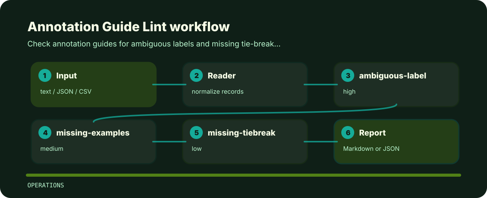

# Annotation Guide Lint

Check annotation guides for ambiguous labels and missing tie-break rules. The command is intentionally direct so it can sit in a local review, a CI step, or a one-off audit.


## Checks in plain language

- `ambiguous-label` - ambiguous label guidance (high); clarify label definition.
- `missing-examples` - examples are missing (medium); add positive and negative examples.
- `missing-tiebreak` - tie-break rule missing (low); define adjudication rule.

## Finding map



## Local check

```bash
git clone https://github.com/mertefekurt/annotation-guide-lint.git
cd annotation-guide-lint
python -m pip install -e ".[dev]"
annotation-guide-lint examples/sample.txt
```

## Check before changing

```bash
ruff check .
pytest
python -m annotation_guide_lint --help
```
