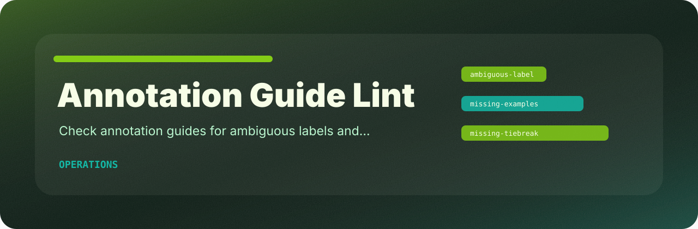

# Annotation Guide Lint

<p align="center">
  
</p>

   

Check annotation guides for ambiguous labels and missing tie-break rules.

## The short version

`annotation-guide-lint` is intentionally small: feed it a file, get deterministic findings, and decide whether the result should block a merge or just guide cleanup.

## Rule surface

| Rule | Severity | What it catches |
| --- | --- | --- |
| `ambiguous-label` | high | ambiguous label guidance |
| `missing-examples` | medium | examples are missing |
| `missing-tiebreak` | low | tie-break rule missing |

## Usage

```bash
python -m pip install -e ".[dev]"
annotation-guide-lint examples/sample.txt
annotation-guide-lint examples/sample.txt --json --fail-on medium
```

## Useful defaults

| Option | Reason |
| --- | --- |
| `--json` | machine-readable output for scripts |
| `--fail-on medium` | stricter CI gate when warnings matter |
| `--format auto` | let the reader detect text, CSV, JSON, or JSONL |

## Local checks

```bash
python -m pip install -e ".[dev]"
ruff check .
pytest
python -m annotation_guide_lint --help
```
